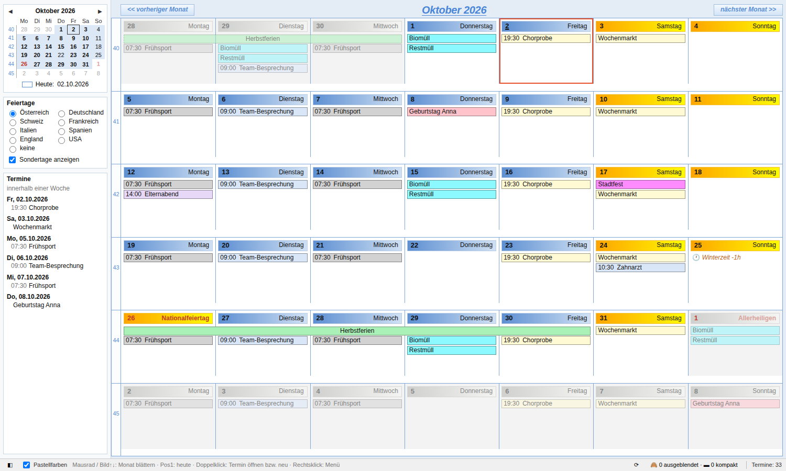

# Kalender-Terminplaner (Calendar Month Planner)

Ein Thunderbird-Add-on mit einer übersichtlichen Monatsansicht im Stil klassischer Terminplaner als eigener Tab: Monat für Monat per Mausrad blättern, mit Feiertagen von acht Ländern für 1900–2100.

🇬🇧 [English version](README.md)



## Funktionen

- Sechs-Wochen-Raster mit Kalenderwochen, blaue Tagesköpfe für Werktage und orange für das Wochenende, einzeilige Einträge mit Uhrzeit und Titel, mehrtägige Termine als durchgehende Balken.
- **Monat für Monat per Mausrad blättern** – die Nachbarmonate sind vorgeladen, daher ohne Wartezeit. Bild↑/↓ und Pos1 (heute) gehen auch.
- Doppelklick auf einen Termin öffnet Thunderbirds eigenen Dialog, Doppelklick auf einen leeren Tag legt einen neuen Termin an.
- Rechtsklick-Menü: öffnen, ausblenden (Serie oder einzelnes Vorkommen), kompakt anzeigen, als ICS exportieren, löschen (mit ICS-Backup).
- **Feiertage 1900–2100** zur Auswahl: Österreich, Deutschland, Schweiz, Frankreich, Italien, Spanien, England & Wales, USA oder keine – mit historischen Regeln, wahlweise mit Sondertagen wie Adventsonntagen, Zeitumstellung oder Muttertag. Feiertage färben den Tag wie ein Wochenende.
- Seitenleiste mit Mini-Kalender und den Terminen der nächsten sieben Tage.
- Farben aus Kategorien oder Kalendern, wahlweise als sanfte Pastelltöne.
- Ist ein Tag voll, zeigt `↓ n` im Tageskopf alle seine Termine.
- Immer aktuell: Änderungen in Thunderbird erscheinen automatisch.
- Deutsche und englische Oberfläche (je nach Thunderbird-Sprache). Arbeitet offline, sendet keine Daten.

Die Regeln für Ausblenden und Kompakt teilt er sich mit dem Add-on [Kalender-Ansicht](https://github.com/HeinzBundschuh/kalender-ansicht): Was in einem ausgeblendet wird, ist auch im anderen ausgeblendet.

## Installation

`.xpi` aus den [Releases](../../releases) laden, dann in Thunderbird *Add-ons und Themes → ⚙ → Add-on aus Datei installieren …*.

Benötigt Thunderbird 128 bis 158. Entwickelt und getestet unter Windows mit Thunderbird 153 ESR und 156.

Das Add-on ist **nicht auf addons.thunderbird.net gelistet**: Es braucht eine eigene Experiment-API, und Thunderbird prüft neue Add-ons dieser Art derzeit nicht. Neue Versionen erscheinen deshalb hier; zum Aktualisieren die neuere `.xpi` über die alte installieren (die Einstellungen bleiben erhalten).

Nach der Installation gibt es die Schaltfläche *Terminplaner* in der Symbolleiste (in allen Bereichen, auch im Kalender) und den Eintrag *Terminplaner öffnen* im Menü *Extras* (mit der **Alt**-Taste einblenden, falls die Menüleiste versteckt ist).

## Tastatur und Maus

| Aktion | So geht's |
|---|---|
| Monat zurück / vor | Mausrad, Bild↑ / Bild↓, Strg+← / Strg+→ |
| Heute | Pos1 |
| Neu laden | F5 |
| Termin öffnen | Doppelklick auf den Termin |
| Neuer Termin | Doppelklick auf einen leeren Tag |
| Menü | Rechtsklick auf einen Termin |
| Alle Termine eines Tages | Klick auf `↓ n` im Tageskopf |

## Funktionsweise

Thunderbird hat noch keine offizielle Kalender-Schnittstelle für Add-ons. Das Add-on nutzt eine kleine **Experiment-API** (`src/api/`), die nur den Datenzugriff bereitstellt: Termine eines Zeitraums lesen, Thunderbirds Termindialog öffnen, Termine exportieren und löschen (immer mit Backup vorher), Kalenderänderungen melden und die Regeln für Ausblenden und Kompakt speichern. Die gesamte Monatsansicht, das Blättern, die Feiertagsberechnung (`src/ui/holidays.js`) und die Menüs stecken in normalen Add-on-Seiten (`src/ui/`).

Weil Experiments in Thunderbirds Innenleben greifen, kann ein großes Thunderbird-Update eine Anpassung nötig machen. Kalenderdaten werden dadurch nicht verändert.

## Bauen

Reines JavaScript/HTML/CSS, kein Build-Schritt. Die `.xpi` erzeugt:

```
python build.py
```

Sie landet in `dist/`. Die Oberfläche lässt sich mit Beispieldaten im normalen Browser ansehen: `src/ui/planer.html?lang=de` öffnen.

## Mitmachen

Fehlermeldungen, Ideen, Übersetzungen und Korrekturen zu Feiertagen sind willkommen – bitte ein [Issue](../../issues) anlegen. Die Texte stehen in `src/ui/i18n.js` (deutscher Text ist der Schlüssel, `EN` enthält Englisch) und `src/_locales/*/messages.json`.

## Datenschutz

Das Add-on sendet keine Daten. Siehe [PRIVACY.md](PRIVACY.md).

## Lizenz

[MIT](LICENSE) © 2026 Heinz Bundschuh
