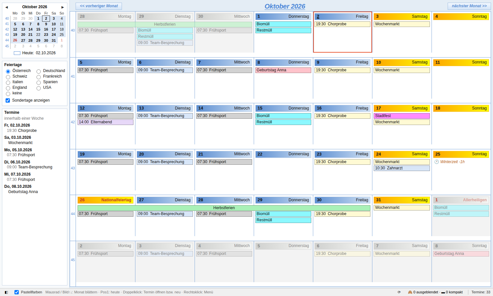

# Kalender-Terminplaner (Calendar Month Planner)

Ein Thunderbird-Add-on mit einer übersichtlichen Monatsansicht im Stil klassischer Terminplaner als eigener Tab: Monat für Monat per Mausrad blättern, mit Feiertagen von acht Ländern für 1900–2100.

🇬🇧 [English version](README.md)



## Funktionen

- Sechs-Wochen-Raster mit Kalenderwochen, blaue Tagesköpfe für Werktage und orange für das Wochenende, einzeilige Einträge mit Uhrzeit und Titel, mehrtägige Termine als durchgehende Balken.
- **Monat für Monat per Mausrad blättern** – die Nachbarmonate sind vorgeladen, daher ohne Wartezeit. Bild↑/↓ und Pos1 (heute) gehen auch.
- Doppelklick auf einen Termin öffnet ihn in einem eigenen Formular (Titel, Kalender, Datum, Uhrzeit, Ort, Beschreibung), Doppelklick auf einen leeren Tag legt einen neuen Termin an. Bei Serien lassen sich Titel, Ort und Beschreibung ändern; Datum und Uhrzeit einer Serie bitte im Thunderbird-Kalender.
- **Verschieben und Kopieren mit der Maus:** Termin auf einen anderen Tag ziehen verschiebt ihn, mit gedrückter Strg- oder Umschalttaste wird er kopiert. Bei Serien gilt das nur für das gezogene Vorkommen. Teilnehmer und Organisator werden nicht mitkopiert, damit keine Einladungen verschickt werden.
- **Löschen mit ×:** Beim Darüberfahren erscheint an jedem Termin ein ×; ein Klick löscht ohne Nachfrage (bei Serien nur dieses Vorkommen), vorher wird ein ICS-Backup gespeichert.
- **Rückgängig** für die letzten 30 Änderungen (Verschieben, Kopieren, Einfügen, Löschen, Bearbeiten, neue Termine): Knopf ↩ in der Statusleiste, Strg+Z oder der Knopf in der Meldung. Gilt, solange der Terminplaner-Tab offen ist.
- Rechtsklick-Menü: öffnen, ausblenden (Serie oder einzelnes Vorkommen), kompakt anzeigen, kopieren (danach Rechtsklick auf einen Tag → Einfügen), als ICS exportieren, löschen (mit ICS-Backup).
- **Feiertage 1900–2100** zur Auswahl: Österreich, Deutschland, Schweiz, Frankreich, Italien, Spanien, England & Wales, USA oder keine – mit historischen Regeln, wahlweise mit Sondertagen wie Adventsonntagen, Zeitumstellung oder Muttertag. Feiertage färben den Tag wie ein Wochenende.
- Seitenleiste mit Mini-Kalender und den Terminen der nächsten sieben Tage.
- Farben der Kalender, wahlweise als sanfte Pastelltöne.
- Ist ein Tag voll, zeigt `↓ n` im Tageskopf alle seine Termine.
- Immer aktuell: Änderungen in Thunderbird erscheinen automatisch.
- Ein Kalender, der nicht antwortet, bremst die Ansicht nicht aus: Nach 10 Sekunden wird er übersprungen und unten rechts gemeldet.
- Deutsche und englische Oberfläche (je nach Thunderbird-Sprache). Arbeitet offline, sendet keine Daten.

Die Regeln für Ausblenden und Kompakt speichert der Terminplaner selbst. Bis Version 1.4.3 teilte er sie mit dem Add-on [Kalender-Ansicht](https://github.com/HeinzBundschuh/kalender-ansicht); das ist mit der offiziellen Kalender-Schnittstelle nicht mehr möglich.

## Installation

`.xpi` aus den [Releases](../../releases) laden, dann in Thunderbird *Add-ons und Themes → ⚙ → Add-on aus Datei installieren …*.

Benötigt Thunderbird 128 bis 158. Entwickelt und getestet unter Windows mit Thunderbird 153 ESR und 156.

Das Add-on gibt es auch auf [addons.thunderbird.net](https://addons.thunderbird.net/thunderbird/addon/calendar-month-planner/) (dort mit automatischen Updates). Neue Versionen erscheinen hier meist früher, weil die Prüfung auf addons.thunderbird.net einige Tage dauert. Zum Aktualisieren die neuere `.xpi` über die alte installieren; die Anzeigeeinstellungen bleiben erhalten.

Nach der Installation gibt es die Schaltfläche *Terminplaner* in der Symbolleiste (in allen Bereichen, auch im Kalender) und den Eintrag *Terminplaner öffnen* im Menü *Extras* (mit der **Alt**-Taste einblenden, falls die Menüleiste versteckt ist).

## Tastatur und Maus

| Aktion | So geht's |
|---|---|
| Monat zurück / vor | Mausrad, Bild↑ / Bild↓, Strg+← / Strg+→ |
| Heute | Pos1 |
| Neu laden | F5 |
| Termin öffnen | Doppelklick auf den Termin |
| Neuer Termin | Doppelklick auf einen leeren Tag |
| Termin verschieben | auf einen anderen Tag ziehen |
| Termin kopieren | mit Strg oder Umschalt auf einen anderen Tag ziehen |
| Termin löschen | × am Termin |
| Rückgängig | Strg+Z oder ↩ in der Statusleiste |
| Menü | Rechtsklick auf einen Termin |
| Alle Termine eines Tages | Klick auf `↓ n` im Tageskopf |

## Funktionsweise

Thunderbird hat noch keine fertige Kalender-Schnittstelle für Add-ons. Das Add-on nutzt deshalb den **veröffentlichten Entwurf der Calendar-API** aus [thunderbird/webext-experiments](https://github.com/thunderbird/webext-experiments) (Ordner `calendar`); die Dateien unter `src/experiments/` sind unveränderte Kopien davon. Darüber liest es die Termine eines Zeitraums, legt Termine an, ändert und löscht sie (immer mit ICS-Backup vorher) und erfährt von Änderungen. `src/ui/planer-api.js` setzt daraus die Funktionen zusammen, die die Monatsansicht braucht, inklusive des eigenen Termin-Formulars. Die gesamte Monatsansicht, das Blättern, die Feiertagsberechnung (`src/ui/holidays.js`) und die Menüs stecken in normalen Add-on-Seiten (`src/ui/`).

Weil Experiments in Thunderbirds Innenleben greifen, kann ein großes Thunderbird-Update eine Anpassung nötig machen. Kalenderdaten werden dadurch nicht verändert.

## Bauen

Reines JavaScript/HTML/CSS, kein Build-Schritt. Die `.xpi` erzeugt:

```
python build.py
```

Sie landet in `dist/`. Die Oberfläche lässt sich mit Beispieldaten im normalen Browser ansehen: `src/ui/planer.html?lang=de` öffnen.

## Mitmachen

Fehlermeldungen, Ideen, Übersetzungen und Korrekturen zu Feiertagen sind willkommen – bitte ein [Issue](../../issues) anlegen. Die Texte stehen in `src/ui/i18n.js` (deutscher Text ist der Schlüssel, `EN` enthält Englisch) und `src/_locales/*/messages.json`.

## Datenschutz

Das Add-on sendet keine Daten. Siehe [PRIVACY.md](PRIVACY.md).

## Lizenz

[MIT](LICENSE) © 2026 Heinz Bundschuh
