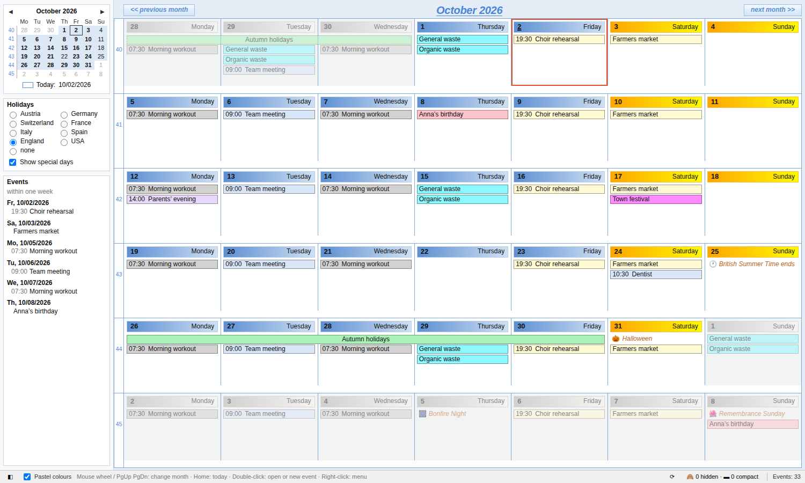

# Calendar Month Planner (Kalender-Terminplaner)

A Thunderbird add-on with a clear month view in the style of classic desktop planners, in its own tab: flip month by month with the mouse wheel, with holidays of eight countries for 1900–2100.

🇩🇪 [Deutsche Version](README.de.md)



## Features

- Six-week grid with week numbers, blue day headers for weekdays and orange ones for weekends, one-line entries with time and title, multi-day events as continuous bars.
- **Flip month by month with the mouse wheel** – neighbouring months are preloaded, so it is instant. PgUp/PgDn and Home (today) work too.
- Double-click an event to open it in Thunderbird's own dialog, double-click an empty day to create a new event.
- Right-click menu: open, hide (series or single occurrence), show compactly, export as ICS, delete (with ICS backup).
- **Holidays 1900–2100** to choose from: Austria, Germany, Switzerland, France, Italy, Spain, England & Wales, USA or none – with historical rules, and optional special days such as Advent Sundays, clock changes or Mother's Day. Holidays colour the day like a weekend.
- Sidebar with a mini calendar and the events of the next seven days.
- Colours from categories or calendars, optionally as soft pastel shades.
- If a day is full, `↓ n` in the day header shows all its events.
- Always up to date: changes made in Thunderbird appear automatically.
- English and German user interface (following Thunderbird's language). Works offline, sends no data.

Hide/compact rules are shared with the add-on [Calendar Hide & Compact](https://github.com/HeinzBundschuh/kalender-ansicht): what you hide in one is hidden in the other.

## Installation

Download the `.xpi` from the [releases](../../releases), then in Thunderbird open *Add-ons and Themes → ⚙ → Install Add-on From File…*.

Requires Thunderbird 128 up to 158. Developed and tested on Windows with Thunderbird 153 ESR and 156.

The add-on is **not listed on addons.thunderbird.net**: it needs its own Experiment API, and Thunderbird currently does not review new add-ons of that kind. New versions are therefore published here; to update, install the newer `.xpi` over the old one (your settings are kept).

After installing there is a *Planner* button in the toolbar (in all spaces, including the calendar) and the entry *Open month planner* in the *Tools* menu (press **Alt** if the menu bar is hidden).

## Keyboard and mouse

| Action | How |
|---|---|
| Previous / next month | mouse wheel, PgUp / PgDn, Ctrl+← / Ctrl+→ |
| Today | Home |
| Reload | F5 |
| Open event | double-click the event |
| New event | double-click an empty day |
| Menu | right-click an event |
| All events of a day | click `↓ n` in the day header |

## How it works

Thunderbird has no official calendar API for add-ons yet. The add-on uses a small **Experiment API** (`src/api/`) that only provides data access: read the events of a date range, open Thunderbird's event dialog, export and delete events (always with a backup first), report calendar changes and store the hide/compact rules. The whole month view, navigation, holiday calculation (`src/ui/holidays.js`) and menus live in normal add-on pages (`src/ui/`).

Because Experiments reach into Thunderbird internals, a major Thunderbird update may require an update of the add-on. No calendar data is changed by that.

## Building

Plain JavaScript/HTML/CSS, no build step. To create the `.xpi`:

```
python build.py
```

The file is written to `dist/`. The user interface can be previewed in a normal browser with demo data: open `src/ui/planer.html?lang=en`.

## Contributing

Bug reports, ideas, translations and corrections to holidays are welcome – please open an [issue](../../issues). Texts live in `src/ui/i18n.js` (German text is the key, `EN` holds English) and `src/_locales/*/messages.json`.

## Privacy

The add-on sends no data anywhere. See [PRIVACY.md](PRIVACY.md).

## Licence

[MIT](LICENSE) © 2026 Heinz Bundschuh
